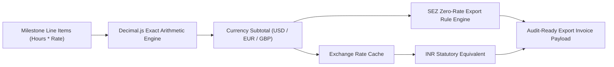

# export-billing-core 💳

> **Learning international IT export billing & invoicing: exploring multi-currency precision arithmetic, milestone ledger generation, and SEZ tax-exemption compliance using TypeScript.**

[](https://www.typescriptlang.org/)
[](https://nodejs.org/)
[](https://opensource.org/licenses/MIT)

---

## 💡 Why I Built This (Learning & Motivation)

Software exporters operating under Software Technology Parks of India (STPI) or Special Economic Zone (SEZ) frameworks face distinct invoicing constraints:
1. **Multi-Currency Floating Invoicing:** Clients in the US, Europe, and UK pay in USD, EUR, or GBP, while internal accounting and compliance require exact foreign currency conversion records.
2. **Floating Point Rounding Errors:** Using standard JavaScript binary floats (`0.1 + 0.2 === 0.30000000000000004`) in financial code causes discrepancies over thousands of billable hours.
3. **Zero-Rated Export Compliance:** Invoices to foreign clients under LUT (Letter of Undertaking) require specific zero-rated tax handling.

I built **`export-billing-core`** as an educational project to understand how to design financial calculation pipelines using **arbitrary-precision decimal arithmetic (`decimal.js`)** and automated currency conversion tracking.

---

## 🏛️ Calculation Flow



---

## 🔬 Key Engineering Learnings

1. **Eliminating IEEE 754 Floating-Point Inaccuracies:**
   - Switched from raw numbers to `Decimal.js` objects for hourly rates and totals.
2. **Statutory Conversion Tracking:**
   - Designed invoice schemas that preserve the exact exchange rate used at the second of invoice creation to satisfy export audit compliance.

---

## 🧪 Quickstart

```bash
# 1. Clone repository
git clone https://github.com/monkey9-Cyber-cat-Spidy/export-billing-core.git
cd export-billing-core

# 2. Install dependencies
npm install

# 3. Run unit tests
npm test
```

---

## 👤 Author
**Kuncham Venkata Satya Manikanta**  
- **Portfolio:** [ai-engineer-eta.vercel.app](https://ai-engineer-eta.vercel.app/)  
- **GitHub:** [@monkey9-Cyber-cat-Spidy](https://github.com/monkey9-Cyber-cat-Spidy)  
- **LinkedIn:** [kvsmanikanta](https://www.linkedin.com/in/kuncham-venkata-satya-manikanta-9715a4321/)
